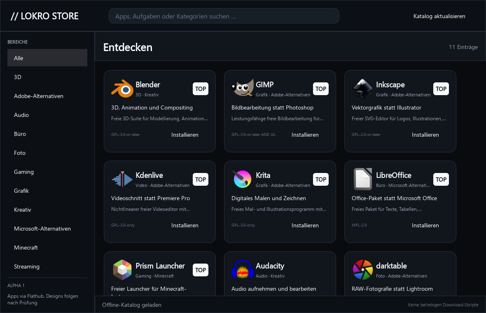

# LOKRO Store

LOKRO Store is the reviewable software and design catalog for LOKRO OS. It is
also usable on other Linux distributions that provide Python, Qt/PySide6 and
Flatpak.



The first alpha deliberately keeps installation rules small and auditable:

- applications are installed from Flathub by exact application ID;
- catalog entries link to their upstream source repositories and licenses;
- arbitrary shell commands, `curl | sh`, AUR helpers and unverified binaries
  are not supported;
- future design packs use checksum-pinned `.lokrodesign` archives and the
  user-scoped `lokro-design-pack` validator from LOKRO OS.

The bundled catalog starts with open-source alternatives for image editing,
drawing, video, audio, office work, streaming and Minecraft launching. The
program has search, category filters, featured items, installation state and
install/update actions.

## Run from source

```bash
python -m venv .venv
. .venv/bin/activate
python -m pip install -e .
lokro-store
```

On Arch Linux, install `pyside6` and `flatpak` first. The app itself does
not require administrator privileges; Flatpaks are installed for the current
user.

## Validate and test

```bash
make validate
make test
```

See [AI_INFO.md](AI_INFO.md) for the repository map, [the catalog
specification](docs/CATALOG_FORMAT.md) for contribution rules and
[PROJECT_STATE.md](docs/PROJECT_STATE.md) for the current hand-off state.

## Status

This repository is pre-release software. The catalog and installer are being
prepared for integration into LOKRO OS after review and CI. No ISO is built in
this repository.

## License

Original repository content is dedicated under [CC0-1.0](LICENSE), matching the
license selected when the repository was created. Third-party names, icons and
screenshots remain under their upstream licenses and may also be trademarks;
see [assets/icons/SOURCES.md](assets/icons/SOURCES.md).
